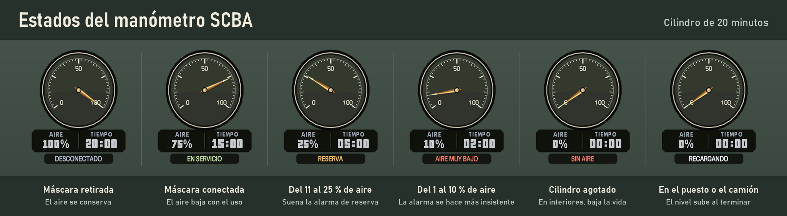

# Guía de uso del SCBA de LSFD

El SCBA es el equipo de respiración autónoma. Llevas el cilindro en la espalda. Puedes ponerte la máscara con antelación y conectar el regulador cuando quieras empezar a usar el aire. La autonomía habitual de un cilindro lleno es de **20 minutos de uso**. Puedes consultar el tiempo restante en el manómetro.

## Equiparse y empezar a respirar

1. Ve a pie a un punto de equipamiento o a un vehículo habilitado y usa `/scba equipar`. Aparece el manómetro y marca **DESCONECTADO**. Puedes desplazarte con el equipo a la espalda y conservar el aire.
2. Usa `/scba mascara` para colocarte la máscara. El regulador sigue desconectado y el cilindro conserva su carga.
3. Usa `/scba aire` para conectar el regulador. Empiezas a respirar del cilindro y el manómetro muestra cómo baja la reserva, tanto en interiores como al aire libre.
4. Repite `/scba aire` para desconectar el regulador y seguir con la máscara puesta. Puedes retomar el consumo desde la misma lectura. Si prefieres quitarte la máscara, repite `/scba mascara`. Al volver a ponértela, el regulador empieza desconectado.

## Ajustar el cilindro y la máscara

El equipo viene colocado de fábrica. Si alguna pieza atraviesa el uniforme o la máscara queda separada de la cara, puedes ajustarla sobre tu personaje.

1. Usa `/scba ajustar equipo` con el cilindro puesto o `/scba ajustar mascara` con la máscara puesta. Con el equipo puesto, `/scba ajustar` muestra las opciones. Si todavía te falta el equipo, el chat te indica que uses `/scba equipar`.
2. En el editor, elige **mover** o **girar** y arrastra el eje que quieras ajustar. El equipo conserva el tamaño de su modelo. Puedes hacer el ajuste con el regulador desconectado para conservar el aire. Si lo llevas conectado, el consumo continúa durante la edición.
3. Pulsa el **icono de guardar**. El chat confirma «Ajuste de la pieza guardado». Pulsa **Esc** si quieres conservar la posición anterior. Cada pieza se guarda por separado.

Los ajustes se conservan al usar `/scba guardar`, al volver a equiparte y al reaparecer durante la misma sesión. En el servidor de pruebas, la siguiente conexión empieza con la calibración original.

Para recuperar la posición y la rotación originales de **ambas piezas**, termina la edición y usa `/scba ajustar reset` con el equipo puesto. Funciona también si llevas la máscara retirada. La próxima vez que te equipes se aplicará la calibración original.

## Leer el manómetro

La aguja y el porcentaje indican cuánto aire queda. **TIEMPO** muestra los minutos y segundos de uso restantes. La franja inferior indica el estado del equipo.

| Estado | Qué significa |
| --- | --- |
| **DESCONECTADO** | El regulador está desconectado. Puedes llevar la máscara puesta o retirada y el aire se conserva. |
| **EN SERVICIO** | Respiras del cilindro y queda más del 25 % de aire. |
| **RESERVA** | Queda entre el 11 % y el 25 % en el indicador. Suena la alarma de reserva. |
| **AIRE MUY BAJO** | Queda entre el 1 % y el 10 % en el indicador. La alarma se hace más insistente. |
| **SIN AIRE** | Llevas la máscara puesta y el cilindro está vacío. En un interior empiezas a perder vida. |
| **RECARGANDO** | Estás recargando o cambiando el cilindro. El indicador conserva la lectura anterior hasta que termina. |

La alarma de reserva emite dos pitidos y la de aire muy bajo, tres. Las alarmas y los jadeos se oyen hasta unos 10 metros en el mismo entorno. El aviso en el chat describe lo que se escucha sin identificar a quien lleva el equipo.

## Recargar o cambiar el cilindro

Retírate la máscara y usa `/scba recargar` a pie junto a una fuente habilitada. **En un puesto fijo** se oye abrir la válvula al empezar la carga. **En un camión detenido** se oye el acople al cambiar el cilindro. Algunos vehículos permiten solo recargar.

El personaje se agacha y la espera depende de cuánto aire falte. Con **75 % de aire** tarda **3,5 segundos**, con **50 %** tarda **5 segundos** y con el cilindro **vacío** tarda **8 segundos**. Una recarga pequeña tarda unos **2 segundos**. En el puesto y en el camión se aplican los mismos tiempos.

Quédate junto al puesto o al camión hasta ver **100 %**. Si usas `/scba cancelar`, te alejas del puesto o el camión se mueve, conservas la carga anterior.

Al terminar verás **100 %** y **DESCONECTADO**. Ponte la máscara con `/scba mascara` y conecta el regulador con `/scba aire` cuando quieras volver a usar el cilindro.

## Si se acaba el aire

- **En un interior**, con la máscara puesta y el cilindro vacío, pierdes **5 puntos de vida cada 2 segundos**. El primer descuento llega al cumplir dos segundos en esas condiciones. Recibes un aviso privado y quienes estén cerca pueden oír tus jadeos.
- Los jadeos se vuelven más frecuentes conforme baja tu vida. La primera pérdida mantiene la cámara estable. Cuando te quedan 60 puntos de vida o menos puede aparecer un mareo suave. A 30 o menos se intensifica.
- **Salir al exterior o retirarte la máscara** detiene el daño, los jadeos y el mareo del equipo. Mientras sigas en el interior con la máscara puesta y el cilindro vacío, desconectar el regulador mantiene el mismo intervalo de daño. Si sales y vuelves a entrar en esas condiciones, el intervalo empieza de nuevo. Para reactivar el suministro necesitas recargar.

## Guardar el equipo

Usa `/scba guardar` a pie donde esté permitido equiparse. Puedes hacerlo con la máscara puesta o retirada. Al guardarlo o al morir desaparecen el equipo y el manómetro. Si vuelves a equiparte durante la misma conexión, recuperas el aire que quedaba. Al volver a conectarte, empiezas sin el equipo y recibes un cilindro lleno la próxima vez que te equipes.

## Comandos

| Comando | Acción |
| --- | --- |
| `/scba` | Ver los comandos disponibles. |
| `/scba equipar` | Recoger el equipo en un lugar habilitado. |
| `/scba mascara` | Ponerte o retirarte la máscara. |
| `/scba aire` | Conectar o desconectar el suministro de aire con la máscara puesta. |
| `/scba ajustar` | Ver las opciones de ajuste con el equipo puesto. |
| `/scba ajustar equipo` | Mover o girar el cilindro y el arnés que llevas en la espalda. |
| `/scba ajustar mascara` | Mover o girar la máscara que llevas puesta. |
| `/scba ajustar reset` | Restablecer la posición y la rotación originales de ambas piezas. |
| `/scba recargar` | Recargar en un puesto o cambiar el cilindro junto a un vehículo habilitado. |
| `/scba cancelar` | Interrumpir la recarga o el cambio de cilindro. |
| `/scba guardar` | Devolver el equipo. |
